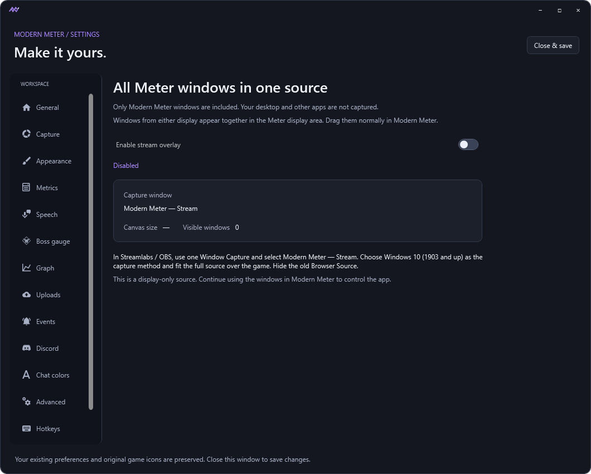
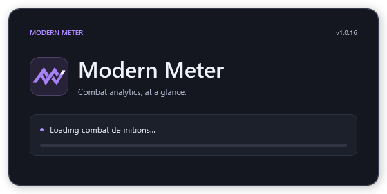
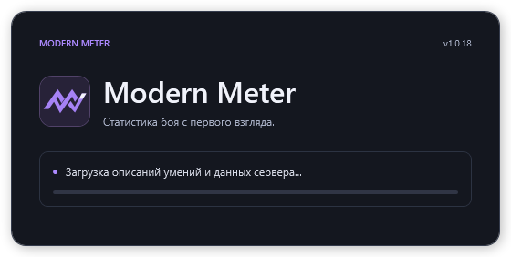
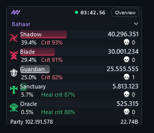
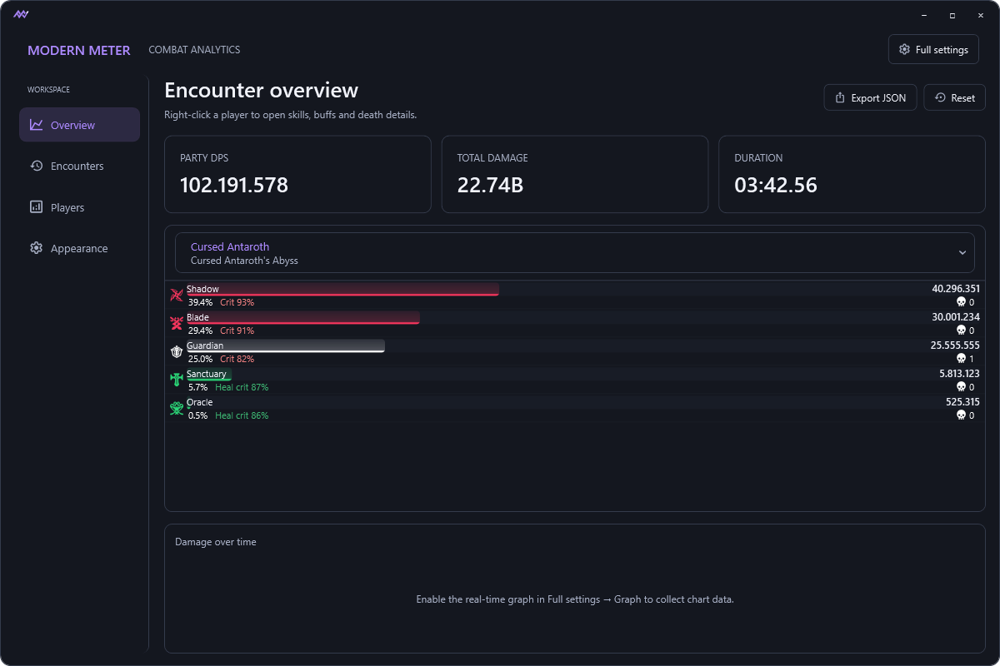
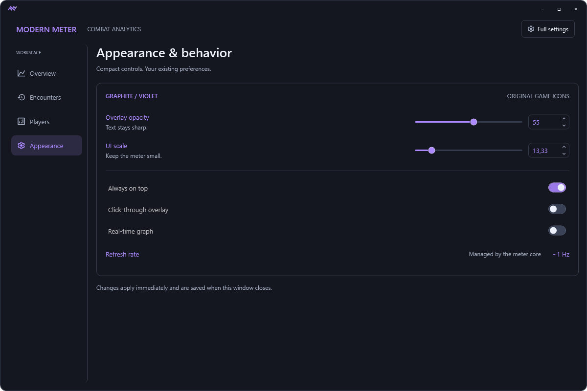
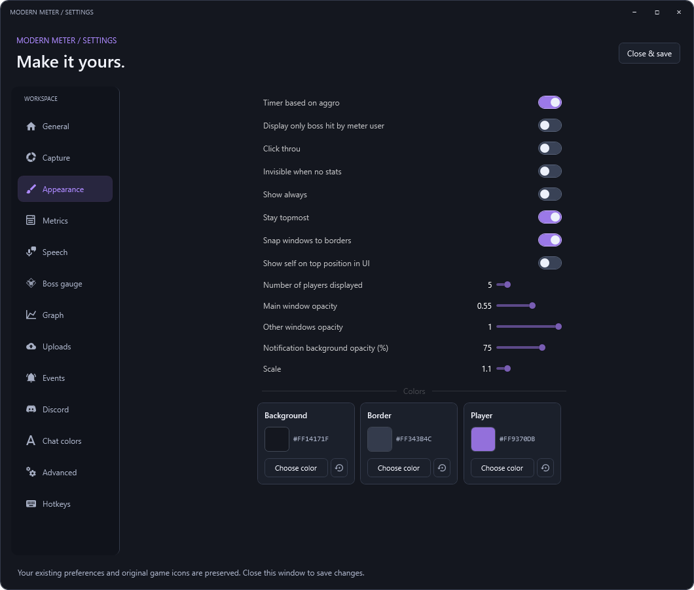
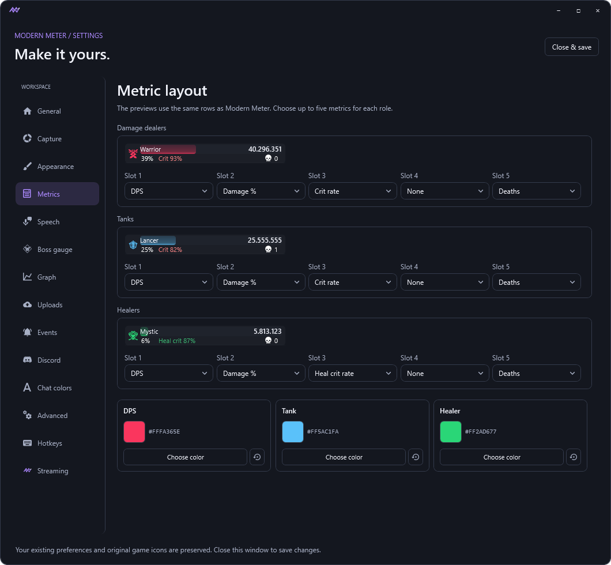
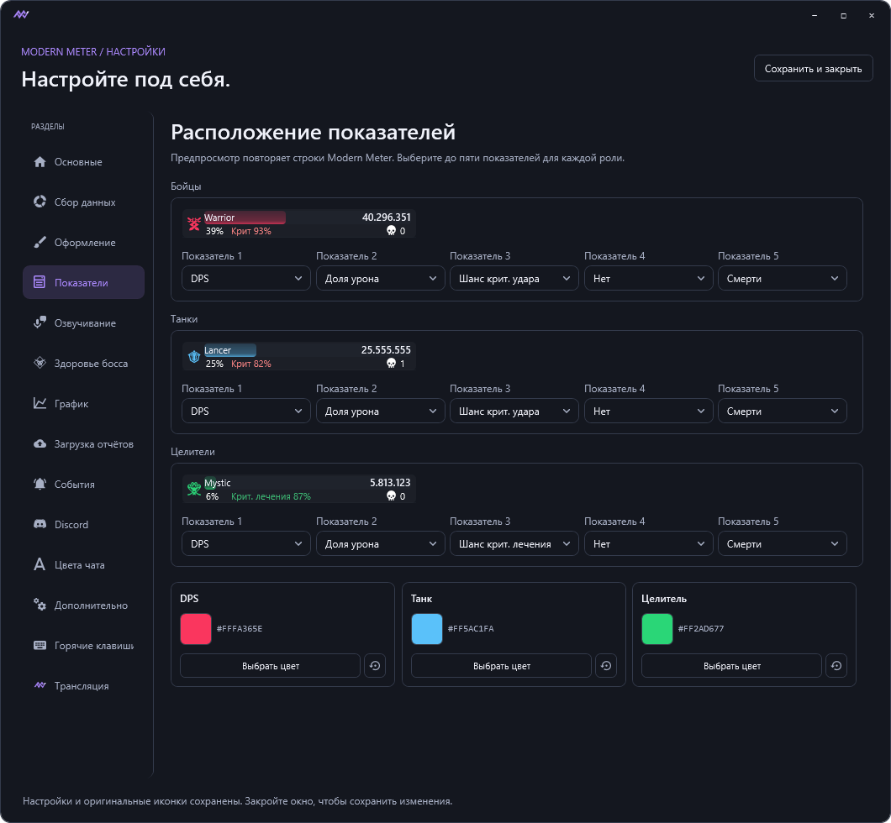
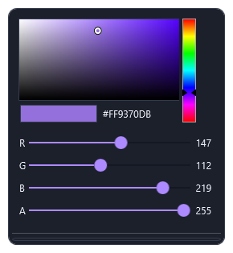

# Modern Meter

Notification cards retain their user-placed anchor as cards arrive, refresh and disappear. Expired or removed cards release their timers; card growth stays on the anchor's monitor. The HUD does not repeatedly toggle hidden windows through the topmost band during combat updates.

A compact combat meter for TERA Toolbox, with an updated interface based on Shinra Meter.

## Asura 100.02 #93

The English and Russian encounter catalogues use the current Asura boss IDs and dungeon names. This includes Revivified Shandra Manaya in Hall of the Argon Queen (Hard), Ferocious Jewel Lizard in Makhaon's Residence, and all three bosses in Cursed Antaroth's Abyss. Boss identification and maximum HP come from the corresponding DataCenter records. When an English name is missing, the catalogue uses the matching Russian text if available.

## Runtime efficiency

Boss gauges detach event subscriptions and release their timer when unloaded. Active enrage phases reuse one timer. Streaming reuses short-lived OS metadata and placement results while preserving the existing visual update cadence and immediate refresh for relevant window or canvas changes. No new runtime dependency is required.

## Install

1. Install the Microsoft .NET 7 Desktop Runtime (x64) if it is not already available.
2. Download the Modern Meter ZIP from the [latest GitHub release](https://github.com/Volframid/modern-meter/releases/latest), and extract the modern-meter folder into Toolbox/mods.
3. Use one meter integration at a time: disable the old Shinra Meter module before enabling Modern Meter.
4. Start Toolbox, then log into your character. Toolbox installs the external-interface dependency automatically.

For module-manager installation, use the module descriptor at https://raw.githubusercontent.com/Volframid/modern-meter/main/module.json. Existing installations update through Toolbox on startup.

Modern Meter uses major, minor and patch versions. New compatible features increment the minor version and reset the patch to zero. Bug fixes increment the patch. Breaking changes increment the major version. The version in the module descriptor is used for the Windows build and must match the release tag.

## Features

- Compact player and party DPS with full integers, aligned configurable metrics, critical/healing rates and death counts. The compact overlay, Encounter overview and Metrics previews show each player's damage share with the same rounded role-colored bar, with a softly translucent fill over a solid lower edge.
- Original game class and skill icons, customizable role colors, transparency and scale.
- A smooth centisecond clock with a transparent timer background and unchanged red/green combat indicator. The Overview button uses the Meter surface; the hover toolbar shares its frame color and opacity.
- Overview with encounter history, player statistics and recorded graphs; right-click a player for original skill, buff and healing details.
- Fourteen settings sections and live interface language selection: English, Russian, German, French, Spanish, Italian, Brazilian Portuguese, Japanese, Korean, Simplified Chinese and Traditional Chinese. Automatic mode follows Windows. Modern interface text and settings labels change immediately in open windows; older runtime diagnostics can fall back to English.
- The frameless MM monogram shared by the application, taskbar, tray, loading screen and every window; transparent artwork has no enclosing tile or background.
- One notification background opacity setting (10–100%, initially 50%) in Full settings → Appearance controls both Meter status messages and separate notification cards. Their surface and frame colors follow the Meter; text and icons stay opaque.
- Frameless caption icons on settings, overview and auxiliary windows; descriptive content headings are retained. Home icons have separate click regions, and export/GitHub menus use the same graphite palette. Player statistics initially center on the Meter monitor after their first data layout; dragging keeps the chosen position.
- Mount notifications check the actual active buff on your character. An effective 2.0 suppresses overlapping 1.5 popups and queued speech; a later effective 1.5 can announce separately. Exact effect IDs also cover sound-only rules. Blue cloud means 1.5, orange cloud means 2.0. A bounded retry uses the existing event filters.
- A new loading screen with live status, a matching update dialog, notification cards, chat, effects and upload-history windows, event editor and color picker.
- Chat and notification functions, including whisper popups when the game is in the background, subject to the user's event and sound settings.

On Asura, Vanguard credit alerts start at 95,000. At 100,000 the popup and speech switch from “Vanguard credits are close to cap” to “Vanguard credits are maxed out”. The popup also shows the current balance and cap. Other supported servers use 75% of their configured cap for the early warning. On Asura, existing self-buff 2.0 mount rules also recognize Primal Omen, Primal Mark and Queen's Wrath (10 seconds), subject to the same active-buff checks and event filters.

Graph collection is **off by default**. Enable it in Full settings → Graph if wanted. Collection runs in the background and the graph is available in Overview; no graph expands beneath the compact meter. Data collection uses some CPU and memory, particularly during long encounters.

Settings and Overview share one dark surface, rounded selection menus and slim scroll indicators. The encounter menu uses the compact meter's background color with a fully opaque surface, so underlying player rows never show through the list. Boss labels use the shared violet accent. Small metric icons are white with transparent badge backgrounds. All numeric settings, including the TTS limit, support left-aligned direct entry and small-step arrow buttons alongside matching violet sliders. Hovering an arrow emphasizes only its glyph, without a box over the number. Press Enter or leave the field to apply typed values. Scale arrows adjust the existing 0–100 size level by 0.1. The role previews are named Warrior, Lancer and Mystic.

Chat-paste waiting time is fixed at 150 ms. Excel DPS averaging uses one second, and automatic idle reset is disabled; these fixed values replace older saved values when the meter starts.

## Streamlabs / OBS: one source for every Meter window

Streaming is **off by default** on fresh installations. Canvas size automatically follows the monitor containing Meter, including while the feature is off. Open **Full settings → Streaming** and enable the stream overlay. In Streamlabs Desktop or OBS, add or retarget one **Window Capture** to **Modern Meter — Stream**. Choose **Windows 10 (1903 and up)** as its capture method. Fit the complete source over the game capture at the canvas dimensions shown in Meter. Set Streamlabs/OBS video output to **60 FPS** for a smooth timer, and hide the former Browser Source or individual Meter capture to avoid duplicate layers.

The compact Meter, encounter overview, player/HPM details, settings, notifications and WPF menus remain separate draggable windows locally. Their WPF content is projected into one transparent native capture surface without sharing native Window roots; changes draw directly without PNG encoding, HTTP or a browser frame queue. UI scaling is included in the full window root, preserving rightmost numbers. Other-monitor windows fit into the Meter-monitor canvas; hidden, minimized and closed source windows disappear. Native operating-system dialogs and other applications are outside this surface. Notification audio continues using the existing Windows/Streamlabs audio setup.

The capture surface keeps its content outside the visible desktop and cannot take keyboard focus. A transparent edge keeps Windows drawing it; normal Always on top controls only affect the interactive Meter windows. Keep the stream feature enabled while using the source. FPS also depends on WPF/Windows rendering, system load and Streamlabs capture/output settings; the feature does not promise a fixed frame rate under every load. This is a display-only source; use the normal Meter windows to control the app.

The feature is off by default on fresh installs. Existing **resources/config/broadcast.json** enablement and compatibility fields are retained; the native implementation does not open the former local HTTP port. After upgrading from the browser version, select the new native target once in Streamlabs/OBS.

## Latest fixes

The Compact overlay, Encounter overview and Metrics previews use the same softer bar fill and solid role-colored lower edge. The fight clock stays green and continues updating smoothly if your character dies while the boss encounter is still active. The boss kill or a confirmed encounter reset ends the timer. Metrics previews use matching bar lengths and damage percentages for all three roles, and reflect the overlay opacity setting.

## Screenshots

Screenshots use fictional player names and sample combat data rendered by Modern Meter.

### Loading screen

Russian loading screen

### Compact overlay

### Encounter overview

Appearance controls and refresh information

Appearance and labeled color controls

Five metric slots for DPS, tanks and healers

Russian interface

Color picker

## Uploads and personal settings

Fresh installations have empty upload username and authentication-token fields, with uploading disabled. The Asura upload, whitelist and glyph service addresses are prefilled. Enter your own credentials to enable uploads. Each server’s token is concealed by default; click its masked field to reveal and edit it. Leaving the field, switching tabs or deactivating the settings window conceals it again, including for newly added servers.

Your settings are created locally on first launch and are not overwritten by module updates. Updating an existing installation preserves its configuration. Do not share resources/config, logs, combat exports or authentication tokens.

The application runtime is named ModernMeter (EXE, DLL and companion configuration files). The obsolete standalone updater executable is removed; Toolbox handles updates. The compatible Autoupdate library is still required by the retained runtime. Existing personal settings are retained during the filename migration.

Notification opacity changes only the card background and decorative icon backing. Text and icons keep their normal visibility. New profiles start at 50%; an explicitly saved notification-opacity setting is preserved. It is independent of other-window opacity. Main and other-window opacity controls show 0–100%. The Scale control uses a 0–100 size level across the existing size range; opening settings preserves the exact saved size.

Chat and party notification bubbles and audio are shown only while TERA is in the background; combat-specific alerts retain their own event rules. Cyrillic text selects an installed Russian Windows speech voice. If that voice is unavailable, a notification sound is used.

The fifth metric slot is aligned to the right edge and defaults to deaths. On the first upgrade, legacy slot-four deaths move to slot five and slot four becomes empty, for damage dealers, tanks and healers. A local migration marker makes this a one-time change; later custom slot choices are preserved on restart. Profiles already migrated by 1.0.2 keep their subsequent choices. Overlay opacity is retained precisely in the local resources/config/modern-ui.json compatibility settings.

The legacy 1–20 Hz control is not used by the retained calculation core. The interface shows its approximately one-second statistics refresh instead; combat-timer animation is independent.

## Source and validation

Modified interface/transport source and the completed Russian satellite resources are in src/. See scripts/build.ps1 to rebuild using the runtime libraries shipped here. The small scripts/NotificationBridge tool reproducibly adds exact notification context and the credit threshold to the retained core library before the UI build. Combat calculation and protocol-data libraries are otherwise retained.

This release is checked with isolated interface, settings, localization, graph, notification, transport and packaging tests. Those checks do not replace gameplay testing on each server and Windows configuration.

## Credits and license

Based on [Shinra Meter](https://github.com/neowutran/ShinraMeter) and the [Asura Toolbox integration](https://github.com/myaak/shinra-meter-asura). Original contributors include Gothos, Foglio, Gl0, neowutran and others. Their MIT copyright and license are retained in LICENSE and source files. Bundled dependencies retain their respective licenses and attribution.
